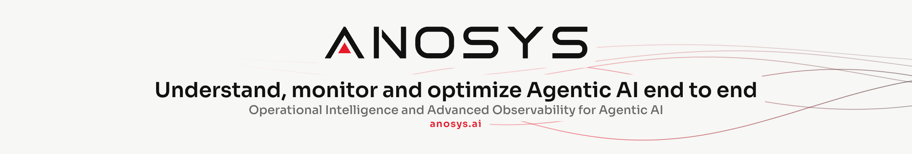
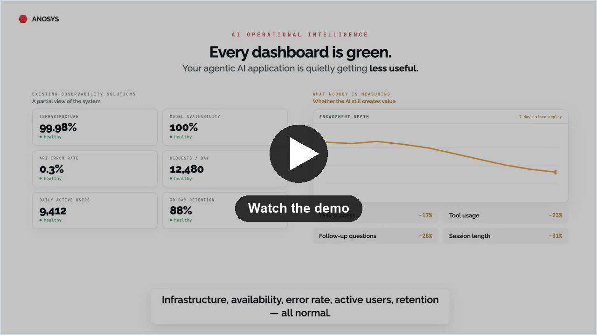
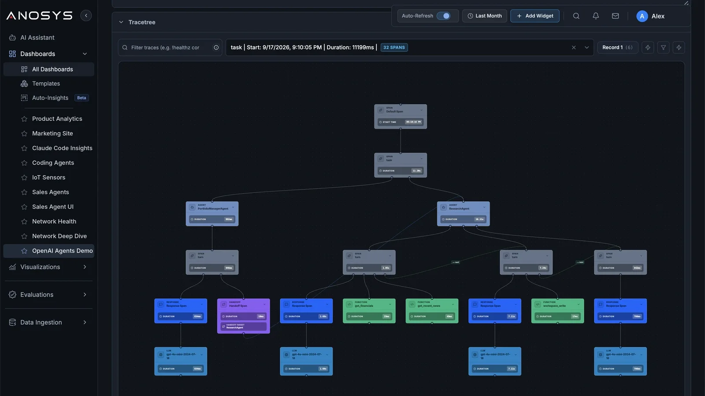
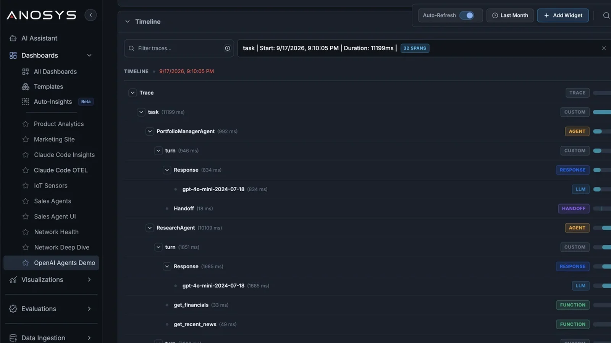
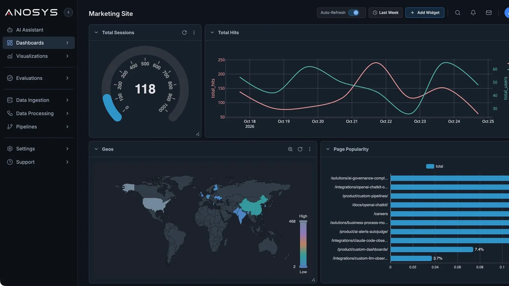

<p align="center">
  <a href="https://anosys.ai">
    <picture>
      <source media="(prefers-color-scheme: dark)" srcset="assets/anosys-banner-dark.png">
      
    </picture>
  </a>
</p>

<h1 align="center">Anosys.ai SDK</h1>

<p align="center">
  See every model call, agent run and tool call your AI makes, with tokens and cost, in two lines of code.
</p>

<p align="center">
  <a href="https://pypi.org/project/anosys-sdk-core/"></a>
  <a href="https://www.npmjs.com/package/anosys-sdk-openai"></a>
  <a href="https://github.com/Anosys-AI/anosys-sdk/actions/workflows/ci.yml"></a>
  <a href="LICENSE"></a>
  
  
  <a href="https://github.com/Anosys-AI/anosys-sdk"></a>
  <a href="https://discord.gg/JhcCfgvmaQ"></a>
</p>

<p align="center">
  <a href="https://anosys.ai/docs/"><b>Documentation</b></a> ·
  <a href="https://console.anosys.ai"><b>Console</b></a> ·
  <a href="https://console.anosys.ai/collect/integrationoptions"><b>Get a key</b></a> ·
  <a href="RELEASE_NOTES.md"><b>Release notes</b></a> ·
  <a href="https://github.com/Anosys-AI/anosys-sdk/issues"><b>Report an issue</b></a> ·
  <a href="https://discord.gg/JhcCfgvmaQ"><b>Discord</b></a>
</p>

<p align="center">
  <a href="https://www.youtube.com/watch?v=GUwJ9sK9gD4"></a>
</p>

<p align="center">
  <a href="https://anosys.ai/assets/img/console/trace-tree.webp"></a>
  <a href="https://anosys.ai/assets/img/console/trace-timeline-agents.webp"></a>
  <a href="https://anosys.ai/assets/img/console/web-analytics-dashboard.webp"></a>
</p>
<p align="center"><sub>Agent trace tree · Trace timeline · Website analytics. Click to enlarge.</sub></p>

Python and JavaScript integrations for [Anosys.ai](https://anosys.ai), the AI Operational Intelligence Platform. They capture model calls, agent runs, tool activity, token usage, estimated cost and application context, and send them to Anosys.ai, where you debug agents, run evaluations, set alerts and track spend.

**Contents:** [Get started](#get-started) · [All integrations](#all-integrations) · [AI coding agents](#use-anosysai-with-ai-coding-agents) · [Privacy and data controls](#privacy-and-data-controls) · [Troubleshooting](#troubleshooting) · [Community and support](#community-and-support) · [Packages](#packages) · [Contributing](#contributing)

## Get started

Create a free account in the [Anosys.ai Console](https://console.anosys.ai), then pick what you want to do. Each path takes a few minutes, and each one uses its own type of key from [Integration options](https://console.anosys.ai/collect/integrationoptions).

| I want to… | Key type | Jump to |
| --- | --- | --- |
| See the LLM calls my app makes | **OpenTelemetry / AI Agents** | [Monitor LLM calls](#monitor-llm-calls-in-your-app) |
| See what my AI agents do, step by step | **OpenTelemetry / AI Agents** | [Debug AI agents](#debug-ai-agents) |
| Know what AI coding assistants cost my team | **Claude Code & Codex CLI** | [Track coding-assistant spend](#track-coding-assistant-spend) |
| Understand visitors and users of my website or app | **Website / Advertising Tracker** | [Website and product analytics](#website-and-product-analytics) |

### Monitor LLM calls in your app

Every call to <picture><source media="(prefers-color-scheme: dark)" srcset="assets/logos/openai-dark.svg"></picture> OpenAI or <picture><source media="(prefers-color-scheme: dark)" srcset="assets/logos/anthropic-dark.svg"></picture> Anthropic is traced with its prompt, response, latency, tokens and cost. Install the package for your provider and create the logger once, before your client:

| Provider | Python 3.10+ | Node.js 18+ | Add at startup |
| --- | --- | --- | --- |
| <picture><source media="(prefers-color-scheme: dark)" srcset="assets/logos/openai-dark.svg"></picture>&nbsp;OpenAI | `pip install anosys-sdk-openai openai` | `npm install anosys-sdk-openai openai` | `AnosysOpenAILogger()` |
| <picture><source media="(prefers-color-scheme: dark)" srcset="assets/logos/anthropic-dark.svg"></picture>&nbsp;Anthropic | `pip install anosys-sdk-anthropic anthropic` | `npm install anosys-sdk-anthropic @anthropic-ai/sdk` | `AnosysAnthropicLogger()` |

```bash
export ANOSYS_API_KEY="your-anosys-key"
```

```python
from openai import OpenAI
from anosys_sdk_openai import AnosysOpenAILogger

AnosysOpenAILogger()  # every OpenAI call from here on is traced
client = OpenAI()
client.chat.completions.create(
    model="gpt-4o-mini",
    messages=[{"role": "user", "content": "Hello"}],
)
```

For <picture><source media="(prefers-color-scheme: dark)" srcset="assets/logos/anthropic-dark.svg"></picture> Anthropic, swap the import and the logger: `from anosys_sdk_anthropic import AnosysAnthropicLogger`, then `AnosysAnthropicLogger()` before `anthropic.Anthropic()`. In JavaScript it's `new AnosysOpenAILogger()` or `new AnosysAnthropicLogger()`. Open the [Console](https://console.anosys.ai) to see the call, its tokens and its cost. <picture><source media="(prefers-color-scheme: dark)" srcset="assets/logos/openrouter-dark.svg"></picture> OpenRouter works through the OpenAI SDK.

### Debug AI agents

See every agent run as a trace: model calls, tool calls, handoffs and subagents, with tokens and cost.

| Framework&nbsp;&nbsp;&nbsp;&nbsp;&nbsp;&nbsp;&nbsp;&nbsp;&nbsp;&nbsp;&nbsp;&nbsp;&nbsp;&nbsp;&nbsp;&nbsp;&nbsp;&nbsp;&nbsp;&nbsp;&nbsp;&nbsp;&nbsp;&nbsp;&nbsp;&nbsp;&nbsp;&nbsp;&nbsp;&nbsp;&nbsp;&nbsp;&nbsp; | Install | Add at startup |
| --- | --- | --- |
| <picture><source media="(prefers-color-scheme: dark)" srcset="assets/logos/openai-dark.svg"></picture>&nbsp;OpenAI&nbsp;Agents&nbsp;SDK | `pip install anosys-sdk-openai-agents`<br>`npm install anosys-sdk-openai-agents @openai/agents` | Python: `add_trace_processor(AnosysOpenAIAgentsLogger())`<br>JS: `addTracingProcessor(new AnosysOpenAIAgentsLogger())` |
| <picture><source media="(prefers-color-scheme: dark)" srcset="assets/logos/claude-dark.svg"></picture>&nbsp;Claude&nbsp;Agent&nbsp;SDK | `pip install anosys-sdk-claude-agents`<br>`npm install anosys-sdk-claude-agents @anthropic-ai/claude-agent-sdk` | Python: `AnosysClaudeAgentsLogger()` before importing `query`<br>JS: `new AnosysClaudeAgentsLogger()`, then `wrapQuery(query)` |

The <picture><source media="(prefers-color-scheme: dark)" srcset="assets/logos/openai-dark.svg"></picture> [OpenAI Agents](packages/python/openai_agents/README.md) and <picture><source media="(prefers-color-scheme: dark)" srcset="assets/logos/claude-dark.svg"></picture> [Claude Agent SDK](packages/python/claude_agents/README.md) guides have complete examples.

### Track coding-assistant spend

See tokens and cost for <picture><source media="(prefers-color-scheme: dark)" srcset="assets/logos/claude-dark.svg"></picture> Claude Code, <picture><source media="(prefers-color-scheme: dark)" srcset="assets/logos/openai-dark.svg"></picture> Codex and <picture><source media="(prefers-color-scheme: dark)" srcset="assets/logos/google-dark.svg"></picture> Antigravity by developer, project, session and model, and spot the expensive ones. One command per tool; it asks for your key and installs the hook. Restart the tool afterwards.

| Tool&nbsp;&nbsp;&nbsp;&nbsp;&nbsp;&nbsp;&nbsp;&nbsp;&nbsp;&nbsp;&nbsp;&nbsp;&nbsp;&nbsp;&nbsp;&nbsp;&nbsp;&nbsp;&nbsp;&nbsp;&nbsp;&nbsp;&nbsp;&nbsp;&nbsp;&nbsp;&nbsp;&nbsp;&nbsp;&nbsp; | Python | JavaScript |
| --- | --- | --- |
| <picture><source media="(prefers-color-scheme: dark)" srcset="assets/logos/claude-dark.svg"></picture>&nbsp;Claude&nbsp;Code | `pip install anosys-claude-code && anosys-claude-code install` | `npx -y anosys-sdk-claude-code install` |
| <picture><source media="(prefers-color-scheme: dark)" srcset="assets/logos/openai-dark.svg"></picture>&nbsp;Codex&nbsp;CLI | `pip install anosys-codex && anosys-codex install` | `npm install -g anosys-sdk-codex && anosys-codex install` |
| <picture><source media="(prefers-color-scheme: dark)" srcset="assets/logos/google-dark.svg"></picture>&nbsp;Antigravity | `pip install anosys-antigravity && anosys-antigravity install` | `npm install -g anosys-sdk-antigravity && anosys-antigravity install` |

Use either the Python or the JavaScript version of a tool, not both. By default only metadata (tokens, cost, models, timing) is sent; see [Privacy and data controls](#privacy-and-data-controls). Antigravity reports activity but not tokens or cost, and has a few extra steps: see the [Antigravity setup guide](docs/ANTIGRAVITY.md).

### Website and product analytics

Page views, sessions, traffic sources, clicks, scroll depth and Web Vitals, and in product mode, signed-in users across sessions. Paste one script into the footer that renders on every page, just before `</body>`:

```html
<script
  async
  src="https://console.anosys.ai/scripts/imp-latest.min.js"
  data-anosys-key="YOUR_WORKSPACE/a/YOUR_ENDPOINT"
></script>
```

`data-anosys-key` only identifies your endpoint; it is not a secret. See the [website analytics](https://anosys.ai/docs/website-analytics/) and [product analytics](https://anosys.ai/docs/product-analytics/) guides. To send your own events, logs or metrics, use the [REST API, webhooks or OpenTelemetry](https://anosys.ai/docs/ingestion/).

## All integrations

| Integration&nbsp;&nbsp;&nbsp;&nbsp;&nbsp;&nbsp;&nbsp;&nbsp;&nbsp;&nbsp;&nbsp;&nbsp;&nbsp;&nbsp;&nbsp;&nbsp;&nbsp;&nbsp;&nbsp;&nbsp;&nbsp;&nbsp;&nbsp;&nbsp;&nbsp;&nbsp;&nbsp; | Python | JavaScript | Example Use Cases | Sample Notebooks |
| --- | --- | --- | --- | --- |
| <picture><source media="(prefers-color-scheme: dark)" srcset="assets/logos/openai-dark.svg"></picture>&nbsp;OpenAI&nbsp;API | [Guide](packages/python/openai/README.md) | [Guide](packages/js/openai/README.md) |  Latency and errors<br> Tokens and cost per request<br> Debugging bad answers | [Chat](examples/anosys_openai_chat_poc.ipynb), [Support copilot](examples/anosys_openai_support_copilot_demo.ipynb) |
| <picture><source media="(prefers-color-scheme: dark)" srcset="assets/logos/openai-dark.svg"></picture>&nbsp;OpenAI&nbsp;Agents&nbsp;SDK | [Guide](packages/python/openai_agents/README.md) | [Guide](packages/js/openai-agents/README.md) |  Agent runs and delegation<br> Tool calls<br> Finding the step that failed | [Agents](examples/anosys_openai_agentic_poc.ipynb), [Research pipeline](examples/anosys_openai_research_pipeline_demo.ipynb) |
| <picture><source media="(prefers-color-scheme: dark)" srcset="assets/logos/anthropic-dark.svg"></picture>&nbsp;Anthropic&nbsp;API | [Guide](packages/python/anthropic/README.md) | [Guide](packages/js/anthropic/README.md) |  Latency and errors<br> Tokens and cost per request<br> Debugging bad answers | [Chat](examples/anosys_anthropic_chat_poc.ipynb), [Support copilot](examples/anosys_anthropic_support_copilot_demo.ipynb) |
| <picture><source media="(prefers-color-scheme: dark)" srcset="assets/logos/claude-dark.svg"></picture>&nbsp;Claude&nbsp;Agent&nbsp;SDK | [Guide](packages/python/claude_agents/README.md) | [Guide](packages/js/claude-agents/README.md) |  Agent runs and delegation<br> Tool calls<br> Finding the step that failed | [Agents](examples/anosys_claude_agents_agentic_poc.ipynb), [Research pipeline](examples/anosys_claude_agents_research_pipeline_demo.ipynb) |
| <picture><source media="(prefers-color-scheme: dark)" srcset="assets/logos/claude-dark.svg"></picture>&nbsp;Claude&nbsp;Code | [Guide](packages/python/claude_code/README.md) | [Guide](packages/js/claude-code/README.md) |  Token and cost tracking and optimization<br> Usage per developer, project and session<br> Expensive sessions and models | — |
| <picture><source media="(prefers-color-scheme: dark)" srcset="assets/logos/openai-dark.svg"></picture>&nbsp;Codex&nbsp;CLI | [Guide](packages/python/codex/README.md) | [Guide](packages/js/codex/README.md) |  Token and cost tracking and optimization<br> Usage per developer, project and session<br> Expensive sessions and models | — |
| <picture><source media="(prefers-color-scheme: dark)" srcset="assets/logos/google-dark.svg"></picture>&nbsp;Antigravity | [Guide](packages/python/antigravity/README.md) | [Guide](packages/js/antigravity/README.md) |  Agent activity<br> Tool calls and commands<br> Session time | — |

More notebooks: [decorators](examples/anosys_core_decorators_poc.ipynb) for your own functions, <picture><source media="(prefers-color-scheme: dark)" srcset="assets/logos/langchain-dark.svg"></picture> [LangChain](examples/anosys_langchain_agentic_poc.ipynb) and <picture><source media="(prefers-color-scheme: dark)" srcset="assets/logos/openrouter-dark.svg"></picture> [OpenRouter](examples/anosys_openrouter_agentic_poc.ipynb). They run in Google Colab or locally.

## Use Anosys.ai with AI coding agents

**Let your coding agent add Anosys.ai.** <picture><source media="(prefers-color-scheme: dark)" srcset="assets/logos/claude-dark.svg"></picture> Claude Code, <picture><source media="(prefers-color-scheme: dark)" srcset="assets/logos/openai-dark.svg"></picture> Codex, <picture><source media="(prefers-color-scheme: dark)" srcset="assets/logos/cursor-dark.svg"></picture> Cursor and other coding agents can add the SDK for you. This repository includes an [`AGENTS.md`](AGENTS.md) that tells them which package to install and where the one line goes. Paste a prompt like this into your agent:

```text
Add Anosys.ai tracing to this project. Use the anosys-sdk package for the LLM
provider or agent framework this project uses, create the Anosys logger once at
startup before any client is created, and read ANOSYS_API_KEY from the environment.
Follow https://github.com/Anosys-AI/anosys-sdk/blob/main/AGENTS.md
```

**Track the agents themselves.** The [coding-assistant hooks](#track-coding-assistant-spend) record what <picture><source media="(prefers-color-scheme: dark)" srcset="assets/logos/claude-dark.svg"></picture> Claude Code, <picture><source media="(prefers-color-scheme: dark)" srcset="assets/logos/openai-dark.svg"></picture> Codex and <picture><source media="(prefers-color-scheme: dark)" srcset="assets/logos/google-dark.svg"></picture> Antigravity do on every developer's machine: sessions, models, tool calls, tokens and cost.

**Give your agent your production data.** The Anosys.ai MCP server lets <picture><source media="(prefers-color-scheme: dark)" srcset="assets/logos/claude-dark.svg"></picture> Claude Code, <picture><source media="(prefers-color-scheme: dark)" srcset="assets/logos/openai-dark.svg"></picture> Codex, <picture><source media="(prefers-color-scheme: dark)" srcset="assets/logos/google-dark.svg"></picture> Antigravity and <picture><source media="(prefers-color-scheme: dark)" srcset="assets/logos/cursor-dark.svg"></picture> Cursor read your traces, problems, evals and architecture, read-only. Create an MCP key (`ak_mcp_...`) in the [Console](https://console.anosys.ai) under **My Profile → MCP Keys**; it is separate from your ingestion key. Then register the server and the `anosys-platform-intelligence` skill for every tool you use:

```bash
export ANOSYS_MCP_API_KEY=ak_mcp_...
npx -y anosys-sdk-mcp install --target all -y
npx -y anosys-sdk-mcp status --target all
```

Use `--target claude-code` (or `codex`, `antigravity`, `cursor`) for one tool, or add `--with-mcp` when you install a [coding-assistant hook](#track-coding-assistant-spend). With `--workspace`, the project config refers to `ANOSYS_MCP_API_KEY` instead of storing the key, so it is safe to commit. Details: [anosys-sdk-mcp](packages/js/mcp/README.md).

**Run the platform in plain language.** Once you sign in, the [AI Assistant](https://anosys.ai/docs/ai-assistant/) in the Console answers questions about your data ("why did Claude Code spend go up yesterday?") and builds dashboards, widgets, alerts, pipelines and reports from a description, so you can set up and change Anosys.ai without leaving the conversation.

## Privacy and data controls

- **Applications** send prompts and responses by default. Use `capture_content=False` (Python), `captureContent: false` (JavaScript) or `ANOSYS_COLLECTION_LEVEL=metadata` to send only ids, timing, models and token counts.
- **Coding tools** send metadata only until each user runs `<tool> privacy full` and accepts the [data collection policy](PRIVACY.md). `<tool> privacy off` stops collection.
- **Anyone can turn collection down:** `ANOSYS_DISABLE=1` turns it off, and a `.anosys` file with `level=metadata` or `level=off` lowers it for a project.
- **Encryption:** set `ANOSYS_ENCRYPTION_KEY` and `ANOSYS_ENCRYPTION_SALT` (shown in the Console) and every content field is encrypted before it leaves your machine. Keep the passphrase out of source control.

Details: [content controls and encryption](docs/DATA_CONTROLS.md). Column reference: [telemetry variables](docs/TELEMETRY_VARIABLES.md), [Claude Code variables](docs/CLAUDE_CODE_VARIABLES.md), [Antigravity variables](docs/ANTIGRAVITY_VARIABLES.md), [column mappings](docs/MAPPINGS.md).

## Troubleshooting

- **Nothing shows up.** Check that `ANOSYS_API_KEY` is set in the process that runs your app, and that the logger is created before the client. Without a valid key the SDK logs `telemetry is disabled` and sends nothing.
- **Coding tool data is missing.** Run `<tool> doctor`, for example `anosys-claude-code doctor`, to see the active hook, the collection level and the local files. Restart the tool after installing.
- **No prompts in coding tool data.** That is the default; run `<tool> privacy full` to include them.

## Community and support

- **Chat with the team and other users** on [Discord](https://discord.gg/JhcCfgvmaQ), or start a thread in [GitHub Discussions](https://github.com/Anosys-AI/anosys-sdk/discussions).
- **Bugs and feature requests:** [open an issue](https://github.com/Anosys-AI/anosys-sdk/issues).
- **Questions and setup help:** email [support@anosys.ai](mailto:support@anosys.ai) or read the [documentation](https://anosys.ai/docs/).
- **Security issues:** report them privately, as described in [SECURITY.md](SECURITY.md).
- **Stay up to date:** ⭐ star this repository, [subscribe to the newsletter](https://anosys.ai/newsletter.html), and follow us on [LinkedIn](https://www.linkedin.com/company/anosys-ai/) and [X](https://x.com/AnosysAI).
- **Contribute:** see [CONTRIBUTING.md](CONTRIBUTING.md) and our [code of conduct](CODE_OF_CONDUCT.md).

## Packages

<details>
<summary>All Python and JavaScript packages</summary>

### Python (3.10 or later)

| Package | Version | Install |
| --- | --- | --- |
| <picture><source media="(prefers-color-scheme: dark)" srcset="assets/logos/anosys-dark.svg"></picture>&nbsp;[anosys-sdk-core](packages/python/core) | 2.1.1 | `pip install anosys-sdk-core` |
| <picture><source media="(prefers-color-scheme: dark)" srcset="assets/logos/openai-dark.svg"></picture>&nbsp;[anosys-sdk-openai](packages/python/openai) | 1.1.0 | `pip install anosys-sdk-openai` |
| <picture><source media="(prefers-color-scheme: dark)" srcset="assets/logos/openai-dark.svg"></picture>&nbsp;[anosys-sdk-openai-agents](packages/python/openai_agents) | 1.1.0 | `pip install anosys-sdk-openai-agents` |
| <picture><source media="(prefers-color-scheme: dark)" srcset="assets/logos/anthropic-dark.svg"></picture>&nbsp;[anosys-sdk-anthropic](packages/python/anthropic) | 1.1.0 | `pip install anosys-sdk-anthropic` |
| <picture><source media="(prefers-color-scheme: dark)" srcset="assets/logos/claude-dark.svg"></picture>&nbsp;[anosys-sdk-claude-agents](packages/python/claude_agents) | 1.1.0 | `pip install anosys-sdk-claude-agents` |
| <picture><source media="(prefers-color-scheme: dark)" srcset="assets/logos/claude-dark.svg"></picture>&nbsp;[anosys-claude-code](packages/python/claude_code) | 0.4.1 | `pip install anosys-claude-code` |
| <picture><source media="(prefers-color-scheme: dark)" srcset="assets/logos/openai-dark.svg"></picture>&nbsp;[anosys-codex](packages/python/codex) | 0.3.1 | `pip install anosys-codex` |
| <picture><source media="(prefers-color-scheme: dark)" srcset="assets/logos/google-dark.svg"></picture>&nbsp;[anosys-antigravity](packages/python/antigravity) | 0.3.1 | `pip install anosys-antigravity` |

### JavaScript (Node.js 18 or later)

| Package | Version | Install |
| --- | --- | --- |
| <picture><source media="(prefers-color-scheme: dark)" srcset="assets/logos/anosys-dark.svg"></picture>&nbsp;[anosys-sdk-core](packages/js/core) | 2.1.1 | `npm install anosys-sdk-core` |
| <picture><source media="(prefers-color-scheme: dark)" srcset="assets/logos/openai-dark.svg"></picture>&nbsp;[anosys-sdk-openai](packages/js/openai) | 1.1.0 | `npm install anosys-sdk-openai openai` |
| <picture><source media="(prefers-color-scheme: dark)" srcset="assets/logos/openai-dark.svg"></picture>&nbsp;[anosys-sdk-openai-agents](packages/js/openai-agents) | 1.1.0 | `npm install anosys-sdk-openai-agents @openai/agents` |
| <picture><source media="(prefers-color-scheme: dark)" srcset="assets/logos/anthropic-dark.svg"></picture>&nbsp;[anosys-sdk-anthropic](packages/js/anthropic) | 1.1.0 | `npm install anosys-sdk-anthropic @anthropic-ai/sdk` |
| <picture><source media="(prefers-color-scheme: dark)" srcset="assets/logos/claude-dark.svg"></picture>&nbsp;[anosys-sdk-claude-agents](packages/js/claude-agents) | 1.1.0 | `npm install anosys-sdk-claude-agents @anthropic-ai/claude-agent-sdk` |
| <picture><source media="(prefers-color-scheme: dark)" srcset="assets/logos/claude-dark.svg"></picture>&nbsp;[anosys-sdk-claude-code](packages/js/claude-code) | 0.4.1 | `npx -y anosys-sdk-claude-code install` |
| <picture><source media="(prefers-color-scheme: dark)" srcset="assets/logos/openai-dark.svg"></picture>&nbsp;[anosys-sdk-codex](packages/js/codex) | 0.3.1 | `npm install -g anosys-sdk-codex` |
| <picture><source media="(prefers-color-scheme: dark)" srcset="assets/logos/google-dark.svg"></picture>&nbsp;[anosys-sdk-antigravity](packages/js/antigravity) | 0.3.1 | `npm install -g anosys-sdk-antigravity` |
| <picture><source media="(prefers-color-scheme: dark)" srcset="assets/logos/anosys-dark.svg"></picture>&nbsp;[anosys-sdk-mcp](packages/js/mcp) | 0.1.0 | `npx -y anosys-sdk-mcp install --target all` |

</details>

## Contributing

Contributions are welcome. See [CONTRIBUTING.md](CONTRIBUTING.md) for how to set up the repository, run the tests and open a pull request.

## License

[Apache License 2.0](LICENSE).


