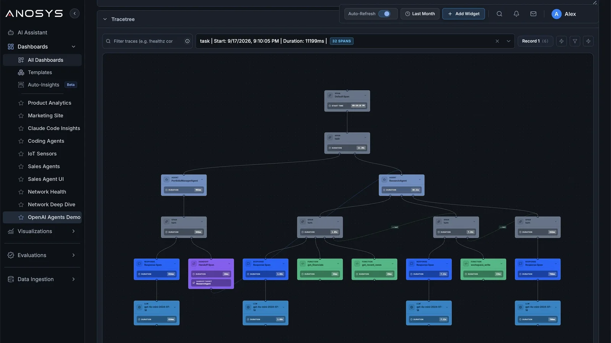
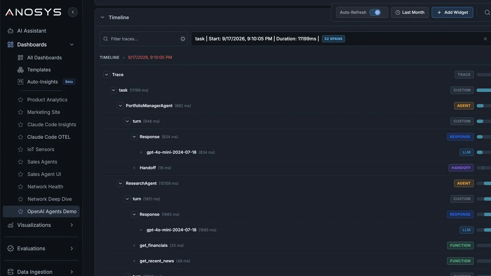
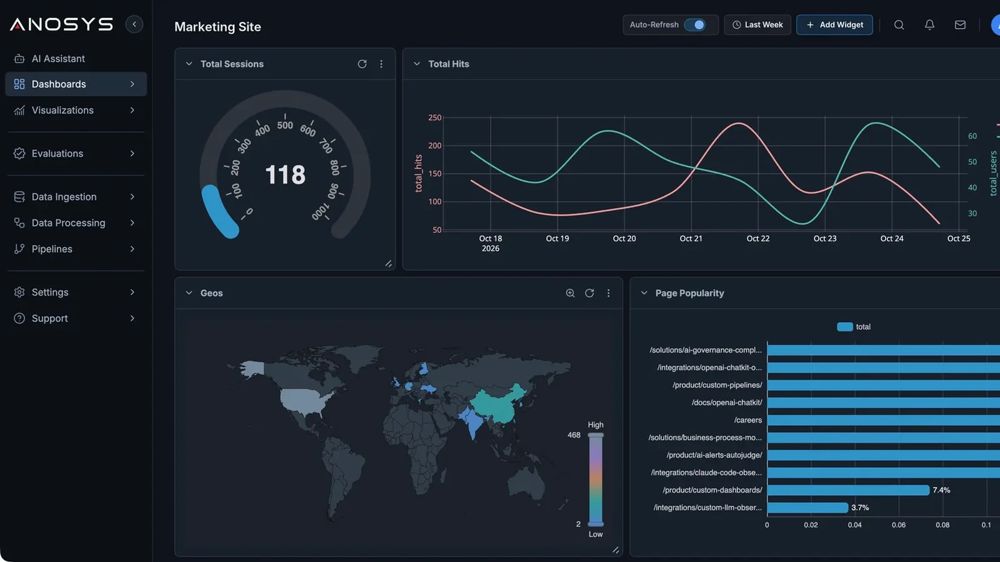

<p align="center">
  <a href="https://anosys.ai">
    <picture>
      <source media="(prefers-color-scheme: dark)" srcset="assets/anosys-new-white-darkmode.svg">
      
    </picture>
  </a>
</p>

<h1 align="center">Anosys.ai SDK</h1>

<p align="center">
  See every model call, agent run and tool call your AI makes, with tokens and cost, in two lines of code.
</p>

<p align="center">
  <a href="https://pypi.org/project/anosys-sdk-core/"></a>
  <a href="https://www.npmjs.com/package/anosys-sdk-openai"></a>
  <a href="https://github.com/Anosys-AI/anosys-sdk/actions/workflows/ci.yml"></a>
  <a href="LICENSE"></a>
  
  
</p>

<p align="center">
  <a href="https://anosys.ai/docs/"><b>Documentation</b></a> ·
  <a href="https://console.anosys.ai"><b>Console</b></a> ·
  <a href="https://console.anosys.ai/collect/integrationoptions"><b>Get a key</b></a> ·
  <a href="RELEASE_NOTES.md"><b>Release notes</b></a> ·
  <a href="https://github.com/Anosys-AI/anosys-sdk/issues"><b>Report an issue</b></a>
</p>

<p align="center">
  <a href="https://anosys.ai/assets/img/console/trace-tree.webp"></a>
  <a href="https://anosys.ai/assets/img/console/trace-timeline-agents.webp"></a>
  <a href="https://anosys.ai/assets/img/console/web-analytics-dashboard.webp"></a>
</p>
<p align="center"><sub>Agent trace tree · Trace timeline · Website analytics. Click to enlarge.</sub></p>

Python and JavaScript integrations for [Anosys.ai](https://anosys.ai), the AI Operational Intelligence Platform. They capture model calls, agent runs, tool activity, token usage, estimated cost and application context, and send them to Anosys.ai, where you debug agents, run evaluations, set alerts and track spend.

## Get started

Create a free account in the [Anosys.ai Console](https://console.anosys.ai), then pick what you want to do. Each path takes a few minutes, and each one uses its own type of key from [Integration options](https://console.anosys.ai/collect/integrationoptions).

| I want to… | Key type | Jump to |
| --- | --- | --- |
| See the LLM calls my app makes | **OpenTelemetry / AI Agents** | [Monitor LLM calls](#monitor-llm-calls-in-your-app) |
| See what my AI agents do, step by step | **OpenTelemetry / AI Agents** | [Debug AI agents](#debug-ai-agents) |
| Know what AI coding assistants cost my team | **Claude Code & Codex CLI** | [Track coding-assistant spend](#track-coding-assistant-spend) |
| Understand visitors and users of my website or app | **Website / Advertising Tracker** | [Website and product analytics](#website-and-product-analytics) |

### Monitor LLM calls in your app

Every call to OpenAI or Anthropic is traced with its prompt, response, latency, tokens and cost. Install the package for your provider and create the logger once, before your client:

| Provider | Python 3.10+ | Node.js 18+ | Add at startup |
| --- | --- | --- | --- |
| OpenAI | `pip install anosys-sdk-openai openai` | `npm install anosys-sdk-openai openai` | `AnosysOpenAILogger()` |
| Anthropic | `pip install anosys-sdk-anthropic anthropic` | `npm install anosys-sdk-anthropic @anthropic-ai/sdk` | `AnosysAnthropicLogger()` |

```bash
export ANOSYS_API_KEY="your-anosys-key"
```

```python
from openai import OpenAI
from anosys_sdk_openai import AnosysOpenAILogger

AnosysOpenAILogger()  # every OpenAI call from here on is traced
client = OpenAI()
client.chat.completions.create(
    model="gpt-4o-mini",
    messages=[{"role": "user", "content": "Hello"}],
)
```

For Anthropic, swap the import and the logger: `from anosys_sdk_anthropic import AnosysAnthropicLogger`, then `AnosysAnthropicLogger()` before `anthropic.Anthropic()`. In JavaScript it's `new AnosysOpenAILogger()` or `new AnosysAnthropicLogger()`. Open the [Console](https://console.anosys.ai) to see the call, its tokens and its cost. OpenRouter works through the OpenAI SDK.

### Debug AI agents

See every agent run as a trace: model calls, tool calls, handoffs and subagents, with tokens and cost.

| Framework | Install | Add at startup |
| --- | --- | --- |
| OpenAI Agents SDK | `pip install anosys-sdk-openai-agents`<br>`npm install anosys-sdk-openai-agents @openai/agents` | Python: `add_trace_processor(AnosysOpenAIAgentsLogger())`<br>JS: `addTracingProcessor(new AnosysOpenAIAgentsLogger())` |
| Claude Agent SDK | `pip install anosys-sdk-claude-agents`<br>`npm install anosys-sdk-claude-agents @anthropic-ai/claude-agent-sdk` | Python: `AnosysClaudeAgentsLogger()` before importing `query`<br>JS: `new AnosysClaudeAgentsLogger()`, then `wrapQuery(query)` |

The [OpenAI Agents](packages/python/openai_agents/README.md) and [Claude Agent SDK](packages/python/claude_agents/README.md) guides have complete examples.

### Track coding-assistant spend

See tokens and cost for Claude Code, Codex and Antigravity by developer, project, session and model, and spot the expensive ones. One command per tool; it asks for your key and installs the hook. Restart the tool afterwards.

| Tool | Python | JavaScript |
| --- | --- | --- |
| Claude Code | `pip install anosys-claude-code && anosys-claude-code install` | `npx -y anosys-sdk-claude-code install` |
| Codex CLI | `pip install anosys-codex && anosys-codex install` | `npm install -g anosys-sdk-codex && anosys-codex install` |
| Antigravity | `pip install anosys-antigravity && anosys-antigravity install` | `npm install -g anosys-sdk-antigravity && anosys-antigravity install` |

Use either the Python or the JavaScript version of a tool, not both. By default only metadata (tokens, cost, models, timing) is sent; see [Privacy and data controls](#privacy-and-data-controls). Antigravity reports activity but not tokens or cost, and has a few extra steps: see the [Antigravity setup guide](docs/ANTIGRAVITY.md).

### Website and product analytics

Page views, sessions, traffic sources, clicks, scroll depth and Web Vitals, and in product mode, signed-in users across sessions. Paste one script into the footer that renders on every page, just before `</body>`:

```html
<script
  async
  src="https://console.anosys.ai/scripts/imp-latest.min.js"
  data-anosys-key="YOUR_WORKSPACE/a/YOUR_ENDPOINT"
></script>
```

`data-anosys-key` only identifies your endpoint; it is not a secret. See the [website analytics](https://anosys.ai/docs/website-analytics/) and [product analytics](https://anosys.ai/docs/product-analytics/) guides. To send your own events, logs or metrics, use the [REST API, webhooks or OpenTelemetry](https://anosys.ai/docs/ingestion/).

## All integrations

| Integration | Python | JavaScript | Example Use Cases | Sample Notebooks |
| --- | --- | --- | --- | --- |
| <picture><source media="(prefers-color-scheme: dark)" srcset="assets/logos/openai-dark.svg"></picture> OpenAI API | [Guide](packages/python/openai/README.md) | [Guide](packages/js/openai/README.md) |  Latency and errors<br> Tokens and cost per request<br> Debugging bad answers | [Chat](examples/anosys_openai_chat_poc.ipynb), [Support copilot](examples/anosys_openai_support_copilot_demo.ipynb) |
| <picture><source media="(prefers-color-scheme: dark)" srcset="assets/logos/openai-dark.svg"></picture> OpenAI Agents SDK | [Guide](packages/python/openai_agents/README.md) | [Guide](packages/js/openai-agents/README.md) |  Agent runs and delegation<br> Tool calls<br> Finding the step that failed | [Agents](examples/anosys_openai_agentic_poc.ipynb), [Research pipeline](examples/anosys_openai_research_pipeline_demo.ipynb) |
| <picture><source media="(prefers-color-scheme: dark)" srcset="assets/logos/anthropic-dark.svg"></picture> Anthropic API | [Guide](packages/python/anthropic/README.md) | [Guide](packages/js/anthropic/README.md) |  Latency and errors<br> Tokens and cost per request<br> Debugging bad answers | [Chat](examples/anosys_anthropic_chat_poc.ipynb), [Support copilot](examples/anosys_anthropic_support_copilot_demo.ipynb) |
| <picture><source media="(prefers-color-scheme: dark)" srcset="assets/logos/claude-dark.svg"></picture> Claude Agent SDK | [Guide](packages/python/claude_agents/README.md) | [Guide](packages/js/claude-agents/README.md) |  Agent runs and delegation<br> Tool calls<br> Finding the step that failed | [Agents](examples/anosys_claude_agents_agentic_poc.ipynb), [Research pipeline](examples/anosys_claude_agents_research_pipeline_demo.ipynb) |
| <picture><source media="(prefers-color-scheme: dark)" srcset="assets/logos/claude-dark.svg"></picture> Claude Code | [Guide](packages/python/claude_code/README.md) | [Guide](packages/js/claude-code/README.md) |  Token and cost tracking and optimization<br> Usage per developer, project and session<br> Expensive sessions and models | — |
| <picture><source media="(prefers-color-scheme: dark)" srcset="assets/logos/openai-dark.svg"></picture> Codex CLI | [Guide](packages/python/codex/README.md) | [Guide](packages/js/codex/README.md) |  Token and cost tracking and optimization<br> Usage per developer, project and session<br> Expensive sessions and models | — |
| <picture><source media="(prefers-color-scheme: dark)" srcset="assets/logos/google-dark.svg"></picture> Antigravity | [Guide](packages/python/antigravity/README.md) | [Guide](packages/js/antigravity/README.md) |  Agent activity<br> Tool calls and commands<br> Session time | — |

More notebooks: [decorators](examples/anosys_core_decorators_poc.ipynb) for your own functions, [LangChain](examples/anosys_langchain_agentic_poc.ipynb) and [OpenRouter](examples/anosys_openrouter_agentic_poc.ipynb). They run in Google Colab or locally.

## Privacy and data controls

- **Applications** send prompts and responses by default. Use `capture_content=False` (Python), `captureContent: false` (JavaScript) or `ANOSYS_COLLECTION_LEVEL=metadata` to send only ids, timing, models and token counts.
- **Coding tools** send metadata only until each user runs `<tool> privacy full` and accepts the [data collection policy](PRIVACY.md). `<tool> privacy off` stops collection.
- **Anyone can turn collection down:** `ANOSYS_DISABLE=1` turns it off, and a `.anosys` file with `level=metadata` or `level=off` lowers it for a project.
- **Encryption:** set `ANOSYS_ENCRYPTION_KEY` and `ANOSYS_ENCRYPTION_SALT` (shown in the Console) and every content field is encrypted before it leaves your machine. Keep the passphrase out of source control.

Details: [content controls and encryption](docs/DATA_CONTROLS.md). Column reference: [telemetry variables](docs/TELEMETRY_VARIABLES.md), [Claude Code variables](docs/CLAUDE_CODE_VARIABLES.md), [Antigravity variables](docs/ANTIGRAVITY_VARIABLES.md), [column mappings](docs/MAPPINGS.md).

## Troubleshooting

- **Nothing shows up.** Check that `ANOSYS_API_KEY` is set in the process that runs your app, and that the logger is created before the client. Without a valid key the SDK logs `telemetry is disabled` and sends nothing.
- **Coding tool data is missing.** Run `<tool> doctor`, for example `anosys-claude-code doctor`, to see the active hook, the collection level and the local files. Restart the tool after installing.
- **No prompts in coding tool data.** That is the default; run `<tool> privacy full` to include them.

## Support

- **Questions and setup help:** email [support@anosys.ai](mailto:support@anosys.ai) or read the [documentation](https://anosys.ai/docs/).
- **Bugs and feature requests:** [open an issue](https://github.com/Anosys-AI/anosys-sdk/issues).
- **Security issues:** please report them privately, as described in [SECURITY.md](SECURITY.md).

⭐ **Star [anosys-sdk](https://github.com/Anosys-AI/anosys-sdk)** to follow new integrations, [subscribe to the newsletter](https://anosys.ai/newsletter.html) for product updates, and follow us on [LinkedIn](https://www.linkedin.com/company/anosys-ai/) and [X](https://x.com/AnosysAI).

## Packages

<details>
<summary>All Python and JavaScript packages</summary>

### Python (3.10 or later)

| Package | Version | Install |
| --- | --- | --- |
| <picture><source media="(prefers-color-scheme: dark)" srcset="assets/logos/anosys-dark.svg"></picture> [anosys-sdk-core](packages/python/core) | 2.0.0 | `pip install anosys-sdk-core` |
| <picture><source media="(prefers-color-scheme: dark)" srcset="assets/logos/openai-dark.svg"></picture> [anosys-sdk-openai](packages/python/openai) | 1.1.0 | `pip install anosys-sdk-openai` |
| <picture><source media="(prefers-color-scheme: dark)" srcset="assets/logos/openai-dark.svg"></picture> [anosys-sdk-openai-agents](packages/python/openai_agents) | 1.1.0 | `pip install anosys-sdk-openai-agents` |
| <picture><source media="(prefers-color-scheme: dark)" srcset="assets/logos/anthropic-dark.svg"></picture> [anosys-sdk-anthropic](packages/python/anthropic) | 1.1.0 | `pip install anosys-sdk-anthropic` |
| <picture><source media="(prefers-color-scheme: dark)" srcset="assets/logos/claude-dark.svg"></picture> [anosys-sdk-claude-agents](packages/python/claude_agents) | 1.1.0 | `pip install anosys-sdk-claude-agents` |
| <picture><source media="(prefers-color-scheme: dark)" srcset="assets/logos/claude-dark.svg"></picture> [anosys-claude-code](packages/python/claude_code) | 0.3.0 | `pip install anosys-claude-code` |
| <picture><source media="(prefers-color-scheme: dark)" srcset="assets/logos/openai-dark.svg"></picture> [anosys-codex](packages/python/codex) | 0.2.0 | `pip install anosys-codex` |
| <picture><source media="(prefers-color-scheme: dark)" srcset="assets/logos/google-dark.svg"></picture> [anosys-antigravity](packages/python/antigravity) | 0.2.0 | `pip install anosys-antigravity` |

### JavaScript (Node.js 18 or later)

| Package | Version | Install |
| --- | --- | --- |
| <picture><source media="(prefers-color-scheme: dark)" srcset="assets/logos/anosys-dark.svg"></picture> [anosys-sdk-core](packages/js/core) | 2.0.0 | `npm install anosys-sdk-core` |
| <picture><source media="(prefers-color-scheme: dark)" srcset="assets/logos/openai-dark.svg"></picture> [anosys-sdk-openai](packages/js/openai) | 1.1.0 | `npm install anosys-sdk-openai openai` |
| <picture><source media="(prefers-color-scheme: dark)" srcset="assets/logos/openai-dark.svg"></picture> [anosys-sdk-openai-agents](packages/js/openai-agents) | 1.1.0 | `npm install anosys-sdk-openai-agents @openai/agents` |
| <picture><source media="(prefers-color-scheme: dark)" srcset="assets/logos/anthropic-dark.svg"></picture> [anosys-sdk-anthropic](packages/js/anthropic) | 1.1.0 | `npm install anosys-sdk-anthropic @anthropic-ai/sdk` |
| <picture><source media="(prefers-color-scheme: dark)" srcset="assets/logos/claude-dark.svg"></picture> [anosys-sdk-claude-agents](packages/js/claude-agents) | 1.1.0 | `npm install anosys-sdk-claude-agents @anthropic-ai/claude-agent-sdk` |
| <picture><source media="(prefers-color-scheme: dark)" srcset="assets/logos/claude-dark.svg"></picture> [anosys-sdk-claude-code](packages/js/claude-code) | 0.3.0 | `npx -y anosys-sdk-claude-code install` |
| <picture><source media="(prefers-color-scheme: dark)" srcset="assets/logos/openai-dark.svg"></picture> [anosys-sdk-codex](packages/js/codex) | 0.2.0 | `npm install -g anosys-sdk-codex` |
| <picture><source media="(prefers-color-scheme: dark)" srcset="assets/logos/google-dark.svg"></picture> [anosys-sdk-antigravity](packages/js/antigravity) | 0.2.0 | `npm install -g anosys-sdk-antigravity` |

</details>

## Contributing

Contributions are welcome. See [CONTRIBUTING.md](CONTRIBUTING.md) for how to set up the repository, run the tests and open a pull request.

## License

[Apache License 2.0](LICENSE).
