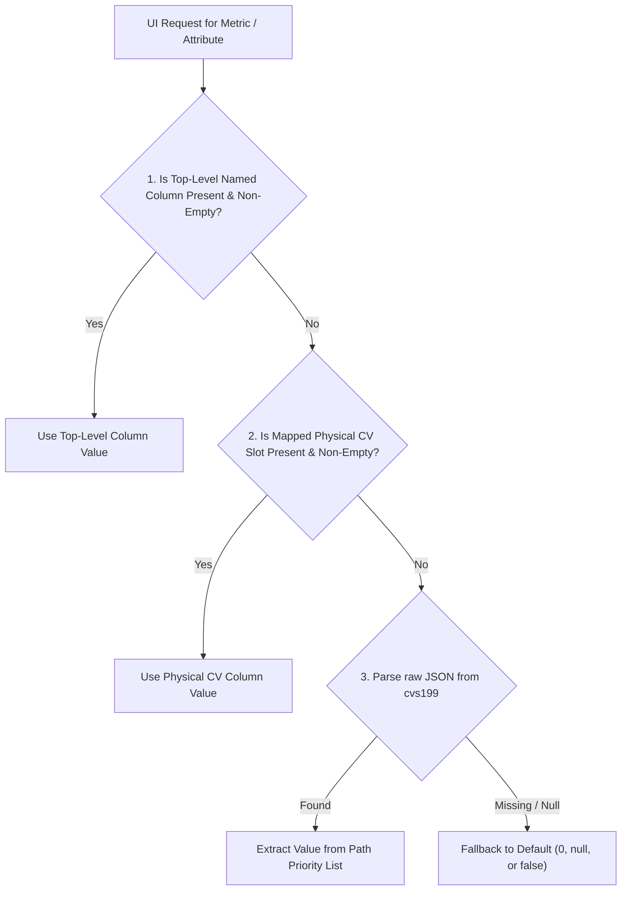

# LLM Telemetry Field Mapping Guide

This document provides an exhaustive, field-by-field mapping between the raw telemetry JSON stored in the `cvs199` (raw data dump) column and the top-level database columns in AnoSys.

Promoting nested telemetry attributes to dedicated database columns accelerates analytical querying, enables indexing in columnar stores (BigQuery, ClickHouse), and powers dashboard visualizations.

---

## 1. Architectural Overview & The UI Hybrid Extraction Model

AnoSys employs a **Dual Schema Architecture** across all SDK packages (Python and TypeScript/JavaScript):

1. **Top-Level Named Columns & Protobuf Schema**: Human-readable columns defined by OpenTelemetry GenAI semantic conventions and AnoSys extensions (e.g. `gen_ai_usage_input_tokens`, `gen_ai_request_model`, `llm_input`).
2. **Physical Custom Variable (CV) Columns**: Indexed database columns (`cvs1`–`cvs200` for strings, `cvn1`–`cvn43` for numbers, `cvb1`–`cvb10` for booleans) used for zero-schema migration and fast aggregation.
3. **Full Raw Payload (`cvs199`)**: Complete JSON snapshot of the span, turn, or agent event.
4. **Reserved System Slots (`cvs198`–`cvs200`)**: Present on every record across all schemas: `cvs198` carries the collection consent/policy label, `cvs199` holds the full raw JSON payload, and `cvs200` identifies the emitter telemetry source tag.

### The UI Hybrid Resolution Flow

The AnoSys Console and UI components query and render telemetry using a 3-tier fallback strategy:



---

## 2. Telemetry Variations Across SDK Emitters in `cvs199`

The internal JSON structure in `cvs199` depends on the emitter library and source tag (`cvs200`):

| Emitter / Source (`cvs200`) | Root Shape in `cvs199` | Attribute Storage Format |
| :--- | :--- | :--- |
| **OpenAI Python Hooks** (`openAI_Python_Telemetry`) | OTel `ReadableSpan` dictionary | **Deserialized Nested**: Attributes are expanded from dot-notation into deeply nested objects under `attributes.gen_ai.*` and `attributes.llm.*`. |
| **OpenAI JS Hooks** (`openAI_Traces`) | OTel Span dictionary | **Flat or Mixed**: Attributes may retain dot-notation keys like `attributes["gen_ai.usage.input_tokens"]` or `attributes.gen_ai.*`. |
| **Anthropic SDK** (`AnthropicTelemetry`) | OTel `ReadableSpan.to_json()` | **Flat Semantic Conventions**: Standard OTel attributes dictionary with dot-delimited string keys: `attributes["gen_ai.*"]`, `attributes["anthropic.*"]`. |
| **Claude Agents SDK** (`ClaudeAgentsTelemetry`) | OTel `ReadableSpan.to_json()` | **Flat Semantic Conventions**: Agent and tool spans with `attributes["gen_ai.*"]`, arguments, and tool outputs. |
| **OpenAI Agents (Span)** (`openAI_Agents_Traces`) | Agentic Event Object | **Direct Event**: Nested under `data.span_data.*` (e.g. `data.span_data.usage`, `data.span_data.model`, `data.span_data.input`). |
| **OpenAI Agents (OTel)** (`openAI_Agents_Telemetry`) | Custom span dict | **Deserialized Objects**: Nested under `attributes_json.gen_ai.*`. |
| **Claude Code Hook** (`ClaudeCodeHook`) | `cvs199Obj` dictionary | **CLI Turn Envelope**: Top-level keys (`user_prompt`, `assistant_text`, `cost_estimate`) plus original raw record under `raw.usage.*`. |
| **Codex CLI Hook** (`CodexHook`) | `raw_to_serialize` object | **CLI Turn / Tool Dump**: `hook_event` containing `tokens`, `user_prompt`, `assistant_output`, and tool execution lists. |
| **Antigravity CLI Hook** (`AntigravityHook`) | `raw_to_serialize` object | **IDE Turn / Tool Dump**: Structured agent session turn containing `user_prompt`, `assistant_text`, `tool_details`, `active_document`, workspace paths, and `hook_event`. |

---

## 3. Comprehensive Field Mapping Reference

### 3.1 Token Usage, Prompt Caching & Cost

| Telemetry Metric | Top-Level Column Name | Physical CV Column | Data Type | Nested Paths in `cvs199` (in fallback evaluation order) |
| :--- | :--- | :--- | :--- | :--- |
| **Input / Prompt Tokens** | `gen_ai_usage_input_tokens` | `cvn1` | `double` | 1. `attributes.gen_ai.usage.input_tokens`<br>2. `attributes["gen_ai.usage.input_tokens"]`<br>3. `attributes.llm.token_count.prompt_tokens`<br>4. `attributes.llm.token_count.input_tokens`<br>5. `data.span_data.usage.input_tokens`<br>6. `data.span_data.usage.prompt_tokens`<br>7. `raw.usage.input_tokens`<br>8. `hook_event.tokens.input_tokens` |
| **Output / Completion Tokens**| `gen_ai_usage_output_tokens`| `cvn2` | `double` | 1. `attributes.gen_ai.usage.output_tokens`<br>2. `attributes["gen_ai.usage.output_tokens"]`<br>3. `attributes.llm.token_count.completion_tokens`<br>4. `attributes.llm.token_count.output_tokens`<br>5. `data.span_data.usage.output_tokens`<br>6. `data.span_data.usage.completion_tokens`<br>7. `raw.usage.output_tokens`<br>8. `hook_event.tokens.output_tokens` |
| **Total Tokens** | `gen_ai_usage_total_tokens` | `cvn3` | `double` | 1. `attributes.gen_ai.usage.total_tokens`<br>2. `attributes["gen_ai.usage.total_tokens"]`<br>3. `attributes.llm.token_count.total_tokens`<br>4. `data.span_data.usage.total_tokens`<br>5. `total_tokens`<br>6. `raw.usage.total_tokens`<br>7. `hook_event.tokens.total_tokens` |
| **Prompt Cache Read Tokens** | `gen_ai_usage_cache_read_tokens` | `cvn4` | `double` | 1. `attributes["gen_ai.usage.cache_read.input_tokens"]`<br>2. `attributes.gen_ai.usage.cache_read.input_tokens`<br>3. `attributes.llm.token_count.cache_read_input_tokens`<br>4. `raw.usage.cache_read_input_tokens`<br>5. `hook_event.tokens.cached_input_tokens`<br>6. `cache_read` |
| **Prompt Cache Creation Tokens**| `gen_ai_usage_cache_creation_tokens`| `cvn5` | `double` | 1. `attributes["gen_ai.usage.cache_creation.input_tokens"]`<br>2. `attributes["gen_ai.usage.cache_write.input_tokens"]`<br>3. `attributes.gen_ai.usage.cache_creation.input_tokens`<br>4. `attributes.llm.token_count.cache_creation_input_tokens`<br>5. `raw.usage.cache_creation_input_tokens`<br>6. `hook_event.tokens.cache_creation_input_tokens`<br>7. `cache_creation` |
| **Reasoning / Thinking Tokens** | `gen_ai_usage_reasoning_tokens` | System Field | `double` | 1. `attributes["gen_ai.usage.reasoning.output_tokens"]`<br>2. `attributes.gen_ai.usage.reasoning.output_tokens`<br>3. `attributes.llm.token_count.reasoning_output_tokens`<br>4. `hook_event.tokens.reasoning_tokens`<br>5. `reasoning_tokens` |
| **Financial Cost (USD)** | `gen_ai_usage_cost` | `cvn7` | `double` | 1. `attributes["gen_ai.usage.cost"]`<br>2. `attributes.gen_ai.usage.cost`<br>3. `cost_estimate`<br>4. `raw.cost_estimate` |
| **Incremental Input Tokens** | `incremental_input` | `cvn9` | `double` | 1. `incremental_input`<br>2. `incremental_tokens.input`<br>3. `raw.incremental_tokens.input` |
| **Incremental Output Tokens** | `incremental_output` | `cvn10` | `double` | 1. `incremental_output`<br>2. `incremental_tokens.output`<br>3. `raw.incremental_tokens.output` |
| **Incremental Total Tokens** | `incremental_total` | `cvn11` | `double` | 1. `incremental_total`<br>2. `incremental_tokens.total`<br>3. `raw.incremental_tokens.total` |
| **Incremental Cost (USD)** | `incremental_cost` | `cvn12` | `double` | 1. `incremental_cost`<br>2. `raw.incremental_cost` |
| **Token Count JSON Blob** | `llm_token_count` | `llm_token_count` | `json` | 1. `attributes.llm.token_count`<br>2. `attributes["llm.token_count"]`<br>3. `data.span_data.usage` |

---

### 3.2 Provider, Operation & Model Context

| Telemetry Metric | Top-Level Column Name | Physical CV Column | Data Type | Nested Paths in `cvs199` (in fallback evaluation order) |
| :--- | :--- | :--- | :--- | :--- |
| **Provider / GenAI System** | `gen_ai_system` | `gen_ai_system` / `cvs17` | `string` | 1. `attributes["gen_ai.provider.name"]`<br>2. `attributes["gen_ai.system"]`<br>3. `attributes.gen_ai.provider.name`<br>4. `attributes.gen_ai.system`<br>5. `attributes.llm.vendor`<br>6. `model_provider`<br>7. `hook_event.provider` |
| **Operation Name** | `gen_ai_operation_name` | `gen_ai_operation_name` | `string` | 1. `attributes["gen_ai.operation.name"]`<br>2. `attributes.gen_ai.operation.name`<br>3. `name` (split before first `.`)<br>4. `data.span_data.type` |
| **Span Kind / Classification** | `gen_ai_span_kind` | `cvs19` / `otel_kind` | `string` | 1. `attributes["gen_ai.span.kind"]`<br>2. `attributes.gen_ai.span.kind`<br>3. `attributes.fi.span.kind`<br>4. `attributes.span.kind`<br>5. `kind` |
| **Requested Model** | `gen_ai_request_model` | `gen_ai_request_model` / `cvs9` | `string` | 1. `attributes["gen_ai.request.model"]`<br>2. `attributes.gen_ai.request.model`<br>3. `attributes.gen_ai.request.parameters.model`<br>4. `attributes.llm.model_name`<br>5. `attributes.llm.invocation_parameters.model`<br>6. `data.span_data.model`<br>7. `primary_model`<br>8. `raw.primary_model`<br>9. `hook_event.model` |
| **Response Model** | `gen_ai_response_model` | `gen_ai_response_model` | `string` | 1. `attributes["gen_ai.response.model"]`<br>2. `attributes.gen_ai.response.model`<br>3. `attributes.output.value.model`<br>4. `attributes["anthropic.message.model"]` |
| **Advisor / Secondary Model** | `advisor_model` | `cvs73` | `string` | 1. `advisor_model`<br>2. `raw.advisor_model` |
| **Response ID** | `gen_ai_response_id` | `gen_ai_response_id` / `otel_status_message` / `cvs77` | `string` | 1. `attributes["gen_ai.response.id"]`<br>2. `attributes.gen_ai.response.id`<br>3. `attributes.output.value.id`<br>4. `data.span_data.response_id`<br>5. `raw_message_id`<br>6. `assistant_msg_id` |
| **Finish / Stop Reasons** | `gen_ai_response_finish_reasons` | `gen_ai_response_finish_reasons` / `cvs6` | `json` / `string` | 1. `attributes["gen_ai.response.finish_reasons"]`<br>2. `attributes.gen_ai.response.finish_reasons`<br>3. `attributes["anthropic.message.stop_reason"]`<br>4. `attributes.output.value.choices[].finish_reason`<br>5. `stop_reason`<br>6. `raw.stop_reason` |
| **Output Type** | `gen_ai_output_type` | `gen_ai_output_type` / `cvs64` | `string` | 1. `attributes["gen_ai.output.type"]`<br>2. `attributes.gen_ai.output.type`<br>3. `attributes.output.value.object` (`chat`->`text`, `embedding`->`embedding`, `image`->`image`)<br>4. `data.span_data.output_type` |

---

### 3.3 Model Parameters (Model Config / Invocations)

These fields are nested under `attributes.gen_ai.request.*`, `attributes.gen_ai.request.parameters.*`, `attributes.llm.invocation_parameters`, or `data.span_data.model_config`:

| Parameter | Top-Level Column Name | Physical CV Column | Data Type | Nested Paths in `cvs199` (in fallback evaluation order) |
| :--- | :--- | :--- | :--- | :--- |
| **Temperature** | `gen_ai_request_temperature` | System Field | `double` | 1. `attributes["gen_ai.request.temperature"]`<br>2. `attributes.gen_ai.request.temperature`<br>3. `attributes.gen_ai.request.parameters.temperature`<br>4. `attributes.llm.invocation_parameters.temperature`<br>5. `data.span_data.model_config.temperature` |
| **Top P** | `gen_ai_request_top_p` | System Field | `double` | 1. `attributes["gen_ai.request.top_p"]`<br>2. `attributes.gen_ai.request.top_p`<br>3. `attributes.gen_ai.request.parameters.top_p`<br>4. `attributes.llm.invocation_parameters.top_p`<br>5. `data.span_data.model_config.top_p` |
| **Top K** | `gen_ai_request_top_k` | System Field | `double` | 1. `attributes["gen_ai.request.top_k"]`<br>2. `attributes.gen_ai.request.top_k`<br>3. `attributes.gen_ai.request.parameters.top_k`<br>4. `attributes.llm.invocation_parameters.top_k`<br>5. `data.span_data.model_config.top_k` |
| **Max Tokens** | `gen_ai_request_max_tokens` | System Field | `double` | 1. `attributes["gen_ai.request.max_tokens"]`<br>2. `attributes.gen_ai.request.max_tokens`<br>3. `attributes.gen_ai.request.parameters.max_tokens`<br>4. `attributes.llm.invocation_parameters.max_tokens`<br>5. `data.span_data.model_config.max_tokens` |
| **Frequency Penalty** | `gen_ai_request_frequency_penalty` | System Field | `double` | 1. `attributes["gen_ai.request.frequency_penalty"]`<br>2. `attributes.gen_ai.request.frequency_penalty`<br>3. `attributes.gen_ai.request.parameters.frequency_penalty`<br>4. `attributes.llm.invocation_parameters.frequency_penalty` |
| **Presence Penalty** | `gen_ai_request_presence_penalty` | System Field | `double` | 1. `attributes["gen_ai.request.presence_penalty"]`<br>2. `attributes.gen_ai.request.presence_penalty`<br>3. `attributes.gen_ai.request.parameters.presence_penalty`<br>4. `attributes.llm.invocation_parameters.presence_penalty` |
| **Stop Sequences** | `gen_ai_request_stop_sequences` | `cvs54` | `json` / `string` | 1. `attributes["gen_ai.request.stop_sequences"]`<br>2. `attributes.gen_ai.request.stop_sequences`<br>3. `attributes.gen_ai.request.parameters.stop`<br>4. `attributes.llm.invocation_parameters.stop`<br>5. `stop_sequence` |
| **Seed** | `gen_ai_request_seed` | System Field | `double` | 1. `attributes["gen_ai.request.seed"]`<br>2. `attributes.gen_ai.request.seed`<br>3. `attributes.gen_ai.request.parameters.seed`<br>4. `attributes.llm.invocation_parameters.seed` |
| **Choice Count (N)** | `gen_ai_request_choice_count` | System Field | `double` | 1. `attributes["gen_ai.request.choice.count"]`<br>2. `attributes.gen_ai.request.choice.count`<br>3. `attributes.gen_ai.request.parameters.n`<br>4. `attributes.llm.invocation_parameters.n` |
| **Tool Choice Setting** | `gen_ai_request_tool_choice` | `cvs15` | `string` | 1. `attributes["gen_ai.request.tool_choice"]`<br>2. `attributes.gen_ai.request.tool_choice`<br>3. `attributes.gen_ai.request.parameters.tool_choice`<br>4. `attributes.llm.invocation_parameters.tool_choice` |
| **Streaming Flag** | `is_streaming` | `cvb2` (OTel Base) / CLI Error Slot* | `boolean` | 1. `attributes["gen_ai.request.stream"]`<br>2. `attributes["anthropic.request.stream"]`<br>3. `attributes["llm.is_streaming"]`<br>4. `attributes.llm.invocation_parameters.stream`<br>5. `attributes.gen_ai.request.parameters.stream`<br>*(Note: In CLI Hooks, `cvb2` is reserved for `is_api_error_message`)* |
| **Full Invocation Params** | `llm_invocation_parameters` | `llm_invocation_parameters` | `json` | 1. `attributes.llm.invocation_parameters`<br>2. `attributes["llm.invocation_parameters"]`<br>3. `attributes.gen_ai.request.parameters`<br>4. `data.span_data.model_config` |

---

### 3.4 Input / Output Content & Messages

| Telemetry Metric | Top-Level Column Name | Physical CV Column | Data Type | Nested Paths in `cvs199` (in fallback evaluation order) |
| :--- | :--- | :--- | :--- | :--- |
| **Human-Readable Prompt / Input** | `llm_input` | `cvs4` | `string` | 1. `user_prompt`<br>2. `attributes.input.value`<br>3. `attributes["input.value"]`<br>4. `attributes.raw.input`<br>5. `data.span_data.input`<br>6. `attributes["gen_ai.tool.call.arguments"]`<br>7. `attributes.gen_ai.tool.call.arguments`<br>8. Flattened from `gen_ai.input.messages` |
| **Human-Readable Completion / Output**| `llm_output` | `cvs5` | `string` | 1. `assistant_text`<br>2. `attributes.output.value`<br>3. `attributes["output.value"]`<br>4. `attributes.raw.output`<br>5. `data.span_data.output`<br>6. `attributes["gen_ai.tool.call.result"]`<br>7. `attributes["anthropic.tool_result.content"]`<br>8. `tool_use_result`<br>9. Flattened from `gen_ai.output.messages` |
| **Input Messages (Structured)** | `gen_ai_input_messages` | `gen_ai_input_messages` | `json` | 1. `attributes["gen_ai.input.messages"]`<br>2. `attributes.gen_ai.input.messages`<br>3. `attributes.llm.input_messages.input_messages`<br>4. `attributes.llm.invocation_parameters.messages` |
| **Output Messages (Structured)**| `gen_ai_output_messages`| `gen_ai_output_messages`| `json` | 1. `attributes["gen_ai.output.messages"]`<br>2. `attributes.gen_ai.output.messages`<br>3. `attributes.llm.output_messages.output_messages`<br>4. `attributes.output.value.choices[].message` |
| **System Instructions / Prompt** | `gen_ai_system_instructions` | `llm_system` | `string` / `json` | 1. `attributes["gen_ai.system_instructions"]`<br>2. `attributes.gen_ai.system_instructions`<br>3. `attributes.llm.system`<br>4. Extracted `system` role message from `gen_ai.input.messages` |
| **Has Reasoning / Thinking** | `has_thinking` | `cvb1` (CLI Hooks: CC, Codex, AG) / `cvb3` (Claude OTel) | `boolean` | 1. `has_thinking`<br>2. `raw.has_thinking`<br>3. Output parts type == `"reasoning"` in `gen_ai.output.messages`<br>4. `reasoning_tokens > 0` |
| **Is API Error Message** | `is_api_error_message` | `cvb2` (CLI Hooks) | `boolean` | 1. `record.isApiErrorMessage`<br>2. `bool(error_obj)`<br>3. `is_api_error_message` |

---

### 3.5 Tools, Commands & MCP (Model Context Protocol)

| Telemetry Metric | Top-Level Column Name | Physical CV Column | Data Type | Nested Paths in `cvs199` (in fallback evaluation order) |
| :--- | :--- | :--- | :--- | :--- |
| **Tool Definitions** | `gen_ai_tool_definitions` | `llm_tools` | `json` | 1. `attributes["gen_ai.tool.definitions"]`<br>2. `attributes.gen_ai.tool.definitions`<br>3. `attributes.llm.tools`<br>4. `attributes.llm.invocation_parameters.tools`<br>5. `data.span_data.tools` |
| **Tool Call ID** | `tool_use_id` | `cvs21` | `string` | 1. `tool_use_id`<br>2. `attributes["gen_ai.tool.call.id"]`<br>3. `raw.tool_use_id` |
| **Tool Execution Result** | `tool_use_result` | `cvs26` | `string` | 1. `tool_use_result`<br>2. `attributes["gen_ai.tool.call.result"]`<br>3. `attributes["anthropic.tool_result.content"]`<br>4. `data.span_data.result` |
| **Tool Invocation Count** | `tool_count` | `cvn41` | `double` | 1. `tool_count`<br>2. `len(tool_calls)`<br>3. `raw.tool_count` |
| **Tool Execution Duration (ms)**| `tool_duration_ms` | `cvn39` | `double` | 1. `tool_duration_ms`<br>2. `raw.tool_duration_ms` |
| **MCP Server Name** | `mcp_server` | `cvs75` | `string` | 1. `data.span_data.server`<br>2. `mcp_meta.server` |
| **MCP Tool Data / Payload** | `mcp_data` | `cvs67` / `cvs76` | `json` / `string` | 1. `data.span_data.mcp_data`<br>2. `data.span_data.result`<br>3. `mcp_meta` |
| **Shell Commands Executed** | `commands` | `cvs90` | `json` / `string` | 1. `commands`<br>2. `raw.commands`<br>3. Shell tool calls extracted from `tool_calls` |
| **Files Modified / Written** | `written_paths` | `cvs91` | `json` / `string` | 1. `written_paths`<br>2. `raw.written_paths`<br>3. File tool operations in `tool_calls` |
| **Files Viewed / Inspected** | `viewed_paths` | `cvs76` | `json` / `string` | 1. `viewed_paths`<br>2. `raw.viewed_paths`<br>3. File read/inspect tool operations in `tool_calls` |
| **Search Queries Executed** | `queries` | `cvs77` | `json` / `string` | 1. `queries`<br>2. `raw.queries`<br>3. Web/code search queries in `tool_calls` |
| **Subagent Invocations** | `subagents` | `cvs78` | `json` / `string` | 1. `subagents`<br>2. `raw.subagents`<br>3. Subagent calls in `tool_calls` |
| **Tool Errors Summary** | `tool_errors` | `cvs79` | `json` / `string` | 1. `tool_errors`<br>2. `raw.tool_errors`<br>3. Tool errors in `tool_calls` |

---

### 3.6 Multi-Agent & Orchestration Context

| Telemetry Metric | Top-Level Column Name | Physical CV Column | Data Type | Nested Paths in `cvs199` (in fallback evaluation order) |
| :--- | :--- | :--- | :--- | :--- |
| **Agent ID** | `gen_ai_agent_id` | `cvs20` | `string` | 1. `attributes["gen_ai.agent.id"]`<br>2. `attributes.gen_ai.agent.id`<br>3. `agent_id`<br>4. `raw.agent_id` |
| **Agent Name** | `gen_ai_agent_name` | `otel_name` / `cvs40` | `string` | 1. `attributes["gen_ai.agent.name"]`<br>2. `attributes.gen_ai.agent.name`<br>3. `data.span_data.name`<br>4. `agent_map_name` |
| **Agent Description / Role** | `gen_ai_agent_description`| `cvs35` | `string` | 1. `attributes["gen_ai.agent.description"]`<br>2. `attributes.gen_ai.agent.description`<br>3. `agent_description` |
| **Conversation / Session ID** | `gen_ai_conversation_id` | `cvs1` (`session_id`) | `string` | 1. `attributes["gen_ai.conversation.id"]`<br>2. `attributes.gen_ai.conversation.id`<br>3. `session_id`<br>4. `sessionId`<br>5. `data.trace_id`<br>*(Note: `user_context.session_id` is protected strictly in `cvs5` and is **never** copied into `gen_ai_conversation_id`)* |
| **Agent Handoffs** | `agent_handoffs` | `cvs62` | `string` | 1. `data.span_data.handoffs`<br>2. Comma-separated handoffs list |
| **From Agent (Handoff Source)**| `agent_from` | `cvs78` | `string` | 1. `data.span_data.from_agent` |
| **To Agent (Handoff Target)** | `agent_to` | `cvs79` | `string` | 1. `data.span_data.to_agent` |
| **Is Agent Execution** | `is_agent` | `cvb1` (OTel Base) / `cvb8` (Claude Code) | `boolean` | 1. `is_agent`<br>2. `attributes["gen_ai.span.kind"] == "AGENT"`<br>3. `data.span_data.type == "agent"` |

---

### 3.7 Trace Lifecycle, Timing & Status

| Telemetry Metric | Top-Level Column Name | Physical CV Column | Data Type | Nested Paths in `cvs199` (in fallback evaluation order) |
| :--- | :--- | :--- | :--- | :--- |
| **Trace ID** | `otel_trace_id` | `otel_trace_id` | `string` | 1. `context.trace_id`<br>2. `spanContext.traceId`<br>3. `data.trace_id`<br>4. `data.id`<br>5. `trace_id` |
| **Span ID** | `otel_span_id` | `otel_span_id` | `string` | 1. `context.span_id`<br>2. `spanContext.spanId`<br>3. `data.id`<br>4. `span_id`<br>5. `uuid` |
| **Parent Span ID** | `otel_parent_span_id` | `cvs11` | `string` | 1. `parent_id`<br>2. `parentSpanId`<br>3. `data.parent_id`<br>4. `parent_uuid` |
| **Span Name** | `otel_name` | `otel_name` | `string` | 1. `name`<br>2. `data.span_data.name`<br>3. `event_type` |
| **Start Timestamp (ms)** | `cvn1` | `cvn1` | `double` | 1. Epoch ms converted from `start_time`<br>2. `data.started_at`<br>3. `start_time_unix_nano / 1000000`<br>4. `timestamp`<br>5. `user_timestamp` |
| **End Timestamp (ms)** | `cvn2` | `cvn2` | `double` | 1. Epoch ms converted from `end_time`<br>2. `data.ended_at`<br>3. `end_time_unix_nano / 1000000` |
| **Duration (ms)** | `otel_duration_ms` | `cvn6` | `double` | 1. `otel_duration_ms`<br>2. `end_time - start_time`<br>3. `data.ended_at - data.started_at`<br>4. `duration_ms`<br>5. `turn_duration_ms` |
| **Status Code** | `otel_status_code` | `otel_status_code` | `string` | 1. `status.status_code` (`0`->`UNSET`, `1`->`OK`, `2`->`ERROR`)<br>2. `status.code` |
| **Status / Error Message** | `otel_status_message` | `cvs11` / `cvs25` | `string` | 1. `status.description`<br>2. `data.error`<br>3. `error_obj`<br>4. `error_message` |
| **Error Type** | `error_type` | `cvs10` | `string` | 1. `attributes["error.type"]`<br>2. `attributes.error.type`<br>3. `error_type` |
| **Time to First Token (TTFT)**| `ttft_ms` | `cvn35` | `double` | 1. `ttft_ms`<br>2. `raw.ttft_ms` |
| **Output Tokens/Sec (OTPS)** | `otps` | `cvn36` | `double` | 1. `otps`<br>2. `raw.otps` |

---

### 3.8 Network, Environment & Identity Context

| Telemetry Metric | Top-Level Column Name | Physical CV Column | Data Type | Nested Paths in `cvs199` (in fallback evaluation order) |
| :--- | :--- | :--- | :--- | :--- |
| **Server Hostname** | `server_address` | `cvs14` | `string` | 1. `attributes["server.address"]`<br>2. `attributes.server.address`<br>3. `resource.attributes["server.address"]`<br>4. `attributes["net.peer.name"]`<br>5. `attributes.net.peer.name` |
| **Server Port** | `server_port` | `cvn3` | `double` | 1. `attributes["server.port"]`<br>2. `attributes.server.port`<br>3. `resource.attributes["server.port"]`<br>4. `attributes["net.peer.port"]`<br>5. `attributes.net.peer.port` |
| **Service Name** | `service_name` | `cvs17` | `string` | 1. `resource.attributes["service.name"]`<br>2. `attributes.service.name` |
| **Project / Repo Name** | `project` | `cvs2` | `string` | 1. `project`<br>2. `raw.project`<br>3. Extracted basename from `cwd` |
| **Current Working Directory** | `cwd` | `cvs12` | `string` | 1. `cwd`<br>2. `raw.cwd` |
| **Git Branch** | `git_branch` | `cvs3` | `string` | 1. `git_branch`<br>2. `raw.git_branch` |
| **Operating System User** | `os_user` | `cvs33` | `string` | 1. `os_user`<br>2. `raw.os_user` |
| **Integration SDK Version** | `integration_version` | `cvs32` | `string` | 1. `integration_version`<br>2. `raw.integration_version` |
| **User Context Payload** | `user_context` | `cvs5` / `cvs3` | `json` / `string` | 1. `user_context`<br>2. `attributes.user_context`<br>3. `attributes.anosys.user_context`<br>*(Treated as content: stripped at `metadata` level; encrypted with `enc2:` at `full` level when encryption key is active)* |
| **Active Document Path** | `active_document` | `cvs70` | `string` | 1. `active_document`<br>2. `raw.active_document`<br>3. IDE editor context |
| **Active Document Language** | `active_document_language`| `cvs71` | `string` | 1. `active_document_language`<br>2. `raw.active_document_language` |
| **User Settings Change** | `user_settings_change` | `cvs75` | `string` | 1. `user_settings_change`<br>2. `raw.user_settings_change` |
| **Transcript File Path** | `transcript_path` | `cvs88` | `string` | 1. `transcript_path`<br>2. `raw.transcript_path` |
| **Artifact Storage Directory**| `artifact_dir` | `cvs89` | `string` | 1. `artifact_dir`<br>2. `raw.artifact_dir` |
| **Workspace Roots** | `workspace_paths` | `cvs93` | `json` / `string` | 1. `workspace_paths`<br>2. `raw.workspace_paths` |
| **IDE Idle State** | `fully_idle` | `cvb3` | `boolean` | 1. `fully_idle`<br>2. `raw.fully_idle` |
| **Consent & Policy Stamp** | `consent` / `consent_level` | `cvs198` | `string` | 1. `cvs198`<br>2. `consent`<br>3. `consent_level`<br>*(Collection level label: `full;<policy_version>` or `metadata;none` in hooks; `full;app` or `metadata;app` in app SDKs)* |
| **Source Tag Identifier** | `from_source` | `cvs200` | `string` | 1. `from_source`<br>2. `source`<br>3. Top-level envelope tag |

---

## 4. Concrete Examples of `cvs199` Payloads

### Example 1: Deserialized Nested OTel Span (OpenAI Python)
```json
{
  "name": "openai.chat",
  "context": {
    "trace_id": "4bf92f3577b34da6a3ce929d0e0e4736",
    "span_id": "00f067aa0ba902b7"
  },
  "parent_id": null,
  "start_time": "2026-10-30T08:00:00.123456Z",
  "end_time": "2026-10-30T08:00:01.456789Z",
  "status": { "status_code": 1 },
  "attributes": {
    "gen_ai": {
      "system": "openai",
      "provider": { "name": "openai" },
      "operation": { "name": "chat" },
      "request": {
        "model": "gpt-4o",
        "temperature": 0.2,
        "max_tokens": 4096
      },
      "response": {
        "id": "chatcmpl-A9BcD3",
        "model": "gpt-4o-2024-08-06",
        "finish_reasons": ["stop"]
      },
      "usage": {
        "input_tokens": 340,
        "output_tokens": 120,
        "total_tokens": 460
      }
    },
    "server": { "address": "api.openai.com", "port": 443 },
    "input": { "value": "User: Summarize quarterly performance" },
    "output": { "value": "Assistant: Here is the executive summary..." }
  },
  "resource": {
    "attributes": { "service.name": "financial-agent-service" }
  }
}
```

### Example 2: Flat Semantic Conventions OTel Span (Anthropic Python & JS)
```json
{
  "name": "anthropic.messages.create",
  "context": {
    "trace_id": "8a3ce929d0e0e47364bf92f3577b34da",
    "span_id": "ba902b700f067aa0"
  },
  "start_time": "2026-10-30T08:15:00.000000Z",
  "end_time": "2026-10-30T08:15:00.850000Z",
  "status": { "status_code": "OK" },
  "attributes": {
    "gen_ai.provider.name": "anthropic",
    "gen_ai.operation.name": "chat",
    "gen_ai.request.model": "claude-3-7-sonnet-20250219",
    "gen_ai.request.temperature": 0.5,
    "gen_ai.request.max_tokens": 8192,
    "gen_ai.usage.input_tokens": 1250,
    "gen_ai.usage.output_tokens": 320,
    "gen_ai.usage.total_tokens": 1570,
    "gen_ai.usage.cache_read.input_tokens": 1024,
    "gen_ai.usage.cache_creation.input_tokens": 226,
    "gen_ai.usage.cost": 0.0084,
    "gen_ai.response.id": "msg_01XyZ987",
    "gen_ai.response.model": "claude-3-7-sonnet-20250219",
    "anthropic.message.stop_reason": "end_turn",
    "server.address": "api.anthropic.com",
    "server.port": 443
  },
  "resource": {
    "attributes": { "service.name": "customer-support-agent" }
  }
}
```

### Example 3: OpenAI Agents Event Trace (`span2json`)
```json
{
  "timestamp": "2026-10-30T08:20:00.000Z",
  "data": {
    "source": "span_end",
    "span_data": {
      "type": "generation",
      "model": "gpt-4o-mini",
      "model_config": {
        "temperature": 0.7,
        "max_tokens": 1000,
        "id": "cfg_agent_planner"
      },
      "usage": {
        "input_tokens": 420,
        "output_tokens": 88,
        "total_tokens": 508
      },
      "input": "Determine next action for ticket #4192",
      "output": "Execute refund verification tool"
    }
  },
  "user_context": { "org_id": "acme_corp", "user_id": "usr_99" }
}
```

### Example 4: Claude Code CLI Turn Record (`cvs199Obj`)
```json
{
  "user_prompt": "Refactor authentication middleware to use JWT verification",
  "assistant_text": "I have updated the verifyToken handler to check expiry.",
  "total_tokens": 24890,
  "cost_estimate": 0.1245,
  "cache_creation": 18200,
  "tool_count": 3,
  "commands": "[\"git status\", \"npm test\"]",
  "written_paths": "[\"src/middleware/auth.ts\"]",
  "tool_duration_ms": 1450,
  "duration_ms": 3820,
  "ttft_ms": 480,
  "otps": 68.4,
  "project": "anosys-sdk-dev",
  "raw": {
    "primary_model": "claude-3-7-sonnet-20250219",
    "usage": {
      "input_tokens": 23500,
      "output_tokens": 1390,
      "cache_read_input_tokens": 16000,
      "cache_creation_input_tokens": 7500
    }
  }
}
```

### Example 5: Antigravity IDE Hook Turn Record (`AntigravityHook`)
```json
{
  "user_prompt": "Fix the authentication token expiry check in auth.py",
  "assistant_text": "I inspected auth.py and updated the timestamp validation.",
  "turn_id": "turn_104",
  "model": "gemini-2.5-pro",
  "project": "anosys-sdk-dev",
  "cwd": "/Users/developer/anosys-sdk-dev",
  "active_document": "/Users/developer/anosys-sdk-dev/src/auth.py",
  "active_document_language": "python",
  "duration_ms": 4210,
  "has_thinking": true,
  "fully_idle": true,
  "commands": "[\"pytest tests/test_auth.py\"]",
  "written_paths": "[\"src/auth.py\"]",
  "viewed_paths": "[\"src/auth.py\", \"tests/test_auth.py\"]",
  "tool_count": 3,
  "tool_duration_ms": 1820,
  "hook_event": {
    "provider": "google",
    "turn": {
      "execution_num": 1,
      "cursor_line": 42,
      "step_count": 5
    }
  }
}
```

---

## 5. UI & Query Implementation Guidelines

When constructing UI inspectors, log cards, or analytical charts:

1. **Top-Level Promotion Priority**:
   ```typescript
   function getField(row: TelemetryRow, namedCol: string, cvCol: string, jsonPaths: string[]): any {
     // 1. Direct top-level column
     if (row[namedCol] !== null && row[namedCol] !== undefined && row[namedCol] !== '') {
       return row[namedCol];
     }
     // 2. Physical CV slot
     if (cvCol && row[cvCol] !== null && row[cvCol] !== undefined && row[cvCol] !== '') {
       return row[cvCol];
     }
     // 3. Fallback to parsing cvs199
     if (row.cvs199) {
       const parsed = typeof row.cvs199 === 'string' ? safeJsonParse(row.cvs199) : row.cvs199;
       if (parsed) {
         for (const path of jsonPaths) {
           const val = getNestedValue(parsed, path);
           if (val !== null && val !== undefined && val !== '') {
             return val;
           }
         }
       }
     }
     return null;
   }
   ```
2. **Encrypted Payloads (`enc2`)**:
   If `ANOSYS_ENCRYPTION_KEY` is active, content fields (including `llm_input`, `llm_output`, `llm_system`, `cvs4`, `cvs5`, `cvs90`, `cvs91`, `cvs199`, and the 9 GenAI JSON/array columns) are encrypted using deterministic AES-256-GCM with PBKDF2-HMAC-SHA256 (format `enc2:`).
   Ciphertext values start with the prefix `enc2:`:
   ```
   enc2:<base64(12-byte nonce + ciphertext + 16-byte tag)>
   ```
   JSON columns receive the encrypted string as valid JSON (`"enc2:..."`), ensuring columnar tables (BigQuery, ClickHouse) remain valid JSON. The UI/consumer decrypts `cvs199` using the client key before JSON parsing.
3. **Array vs. Object Coercion**:
   Fields like `gen_ai_response_finish_reasons`, `commands`, and `written_paths` may be serialized as JSON strings or raw arrays depending on database ingestion tiers. Parsers should normalize with `typeof val === 'string' ? JSON.parse(val) : val`.
